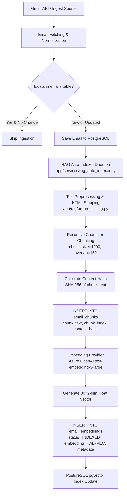
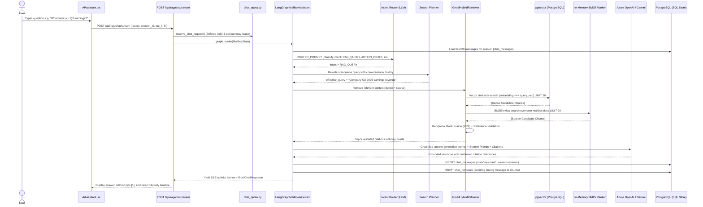
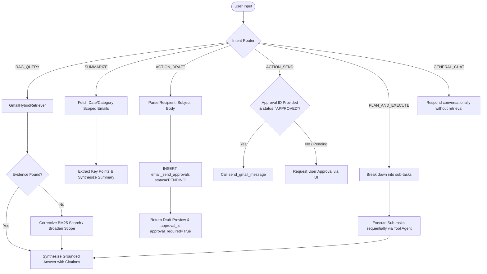
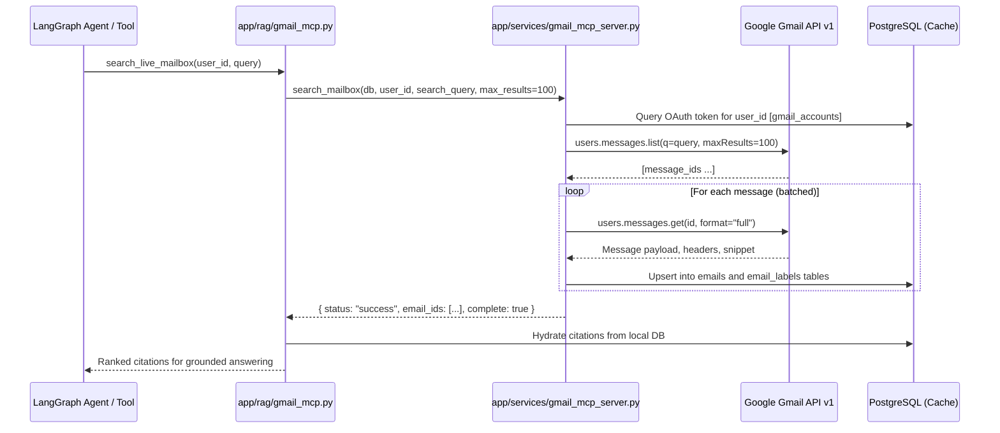
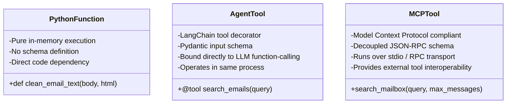

# VC11 — Complete AI, RAG, Agent & MCP Architecture

> **Verification:** Verified directly against `backend/app/rag/*` (`graph_agent.py`, `agent.py`, `chains.py`, `retrieval.py`, `tools.py`, `chunking.py`, `indexing.py`, `embeddings.py`, `pgvector_store.py`, `adaptive.py`, `gmail_mcp.py`, `search_plan.py`), `backend/app/services/*` (`rag_indexer.py`, `rag_auto_indexer.py`, `email_chunker.py`, `embedding_provider.py`, `gmail_mcp_server.py`, `llm_provider.py`), and `LANGGRAPH.md`.

---

## Table of Contents

1. [AI Subsystem Overview](#1-ai-subsystem-overview)
2. [Email Ingestion, Chunking & Embedding Pipeline](#2-email-ingestion-chunking--embedding-pipeline)
   - [2.1 Text Preprocessing & Cleaning](#21-text-preprocessing--cleaning)
   - [2.2 Chunking Strategy & Content Hashing](#22-chunking-strategy--content-hashing)
   - [2.3 Vector Embeddings & pgvector Storage](#23-vector-embeddings--pgvector-storage)
   - [2.4 Deduplication & Update Lifecycle](#24-deduplication--update-lifecycle)
3. [AI Question-Answering Pipeline (RAG)](#3-ai-question-answering-pipeline-rag)
   - [3.1 End-to-End Execution Sequence](#31-end-to-end-execution-sequence)
   - [3.2 The 7 Search & Retrieval Mechanisms Explained](#32-the-7-search--retrieval-mechanisms-explained)
4. [Agent Architecture: LangGraph & LangChain](#4-agent-architecture-langgraph--langchain)
   - [4.1 The 10 Production Agent Patterns](#41-the-10-production-agent-patterns)
   - [4.2 Agent Decision Logic & Workflow](#42-agent-decision-logic--workflow)
   - [4.3 Catalogue of all 18 Registered Tools](#43-catalogue-of-all-18-registered-tools)
   - [4.4 Human-in-the-Loop Approval Mechanism](#44-human-in-the-loop-approval-mechanism)
5. [Model Context Protocol (MCP) Architecture](#5-model-context-protocol-mcp-architecture)
   - [5.1 MCP In-Process vs. Standalone Server](#51-mcp-in-process-vs-standalone-server)
   - [5.2 MCP Server & Client Execution Flow](#52-mcp-server--client-execution-flow)
   - [5.3 Tool Types: Python Function vs. Agent Tool vs. MCP Tool](#53-tool-types-python-function-vs-agent-tool-vs-mcp-tool)
6. [Implementation Status: Implemented vs. Planned](#6-implementation-status-implemented-vs-planned)

---

## 1. AI Subsystem Overview

VC11 features an enterprise-grade AI architecture designed specifically for personal email management:
- **Orchestration:** LangGraph `StateGraph` with state checkpointing (SQLite or PostgreSQL), falling back gracefully to LangChain ReAct loops when LangGraph is uninstalled.
- **Vector Engine:** PostgreSQL with the `pgvector` extension utilizing 3072-dimensional half-precision vectors (`HALFVEC(3072)`).
- **Default Embedding Model:** Azure OpenAI `text-embedding-3-large` (3072 dimensions).
- **Default Chat Model:** Azure OpenAI `gpt-4.1-mini` or Google Gemini `gemini-2.5-flash` with developer override options.
- **Hybrid Retrieval:** Dense vector cosine similarity combined with sparse BM25 keyword matching via Reciprocal Rank Fusion (RRF).
- **Observability:** LangSmith tracing and frontend Server-Sent Events (SSE) telemetry.

---

## 2. Email Ingestion, Chunking & Embedding Pipeline



### 2.1 Text Preprocessing & Cleaning
*File:* `app/rag/preprocessing.py`
- HTML bodies are stripped of scripts, styles, metadata, and tracking pixels using BeautifulSoup.
- Whitespace is normalized, email signatures and long quoted reply chains are stripped if requested, while retaining timestamps, sender names, and forward headers.

### 2.2 Chunking Strategy & Content Hashing
*File:* `app/services/email_chunker.py` and `app/rag/chunking.py`
- **Strategy:** `recursive_character` chunking using LangChain's `RecursiveCharacterTextSplitter`.
- **Chunk Size:** 1,000 characters with an overlap of 150 characters.
- **Separators:** `["\n\n", "\n", ". ", " ", ""]` to preserve sentence and paragraph boundaries.
- **Content Hash:** A SHA-256 digest of the chunk text is generated and stored in `email_chunks.content_hash`.

### 2.3 Vector Embeddings & pgvector Storage
*File:* `app/services/embedding_provider.py` and `app/models/rag.py`
- **Embedded Content:** The model embeds a formatted header prefix plus the chunk text:
  ```text
  Subject: {email_subject}
  From: {sender_email}
  Date: {email_sent_at}
  
  {chunk_text}
  ```
- **Vector Dimensions:** 3072 floats.
- **Data Type:** `HALFVEC(3072)` (16-bit floating point vector via `pgvector`), cutting memory footprint and index storage in half while retaining full cosine accuracy.
- **Metadata Enriched in `email_embeddings` Table:**
  - `email_id` (UUID foreign key)
  - `email_subject` (Text)
  - `sender_email` (Text)
  - `recipient_emails` (Array of Text)
  - `email_sent_at` (Timestamptz)
  - `vector_collection` (`"postgres_halfvec_3072"`)
  - `vector_record_id` (String identifier)
  - `metadata_json` (JSONB)

### 2.4 Deduplication & Update Lifecycle
1. **Deduplication:** Before calling the embedding API, the pipeline queries `email_embeddings` by `content_hash`. If a matching hash already exists with `status = 'INDEXED'`, embedding generation is skipped.
2. **Updates:** If an email body is updated, the previous chunks and embeddings are deleted via database `CASCADE` relationships or marked `OUTDATED`, and fresh chunks are indexed.

---

## 3. AI Question-Answering Pipeline (RAG)

### 3.1 End-to-End Execution Sequence



### 3.2 The 7 Search & Retrieval Mechanisms Explained

VC11 incorporates 7 distinct search and reasoning mechanisms:

| # | Mechanism | Implementation | Best Used For |
|---|---|---|---|
| 1 | **Relational SQL Search** | `app/api/routes/emails.py:list_emails` | Direct filtering by folder (`inbox_only`), read status, sender, or exact recipient. |
| 2 | **Live Gmail API Search** | `app/services/gmail_mcp_server.py:search_mailbox` | Freshness-sensitive queries finding emails that arrived moments ago and are not yet synchronized. |
| 3 | **pgvector Dense Search** | `app/rag/pgvector_store.py` (`<=>` cosine distance) | Conceptual, semantic queries where keywords do not match (e.g. "apartment lease" matches "residential tenancy agreement"). |
| 4 | **Hybrid RAG (Dense + BM25)** | `app/rag/retrieval.py:GmailHybridRetriever` | General mailbox questions combining semantic intent with precise keyword matches (order IDs, flight numbers). |
| 5 | **LLM Reasoning & Routing** | `app/rag/agent.py:ROUTER_PROMPT` | Determining user intent (question vs. draft action vs. scheduling vs. inbox summary). |
| 6 | **Agent Tool Execution** | `app/rag/tools.py` (18 LangChain `@tool` functions) | Autonomous multi-step operations (e.g., fetch attachment metadata, find thread, summarize thread). |
| 7 | **MCP Tool Execution** | `app/rag/gmail_mcp.py` via `services/gmail_mcp_server.py` | Standalone, out-of-process, protocol-bound live discovery over standard I/O. |

---

## 4. Agent Architecture: LangGraph & LangChain

### 4.1 The 10 Production Agent Patterns

VC11 implements 10 production agent patterns without requiring monolithic frameworks:

1. **RAG Pattern:** Grounded question answering strictly backed by source citations.
2. **Tool-Calling Agent:** Direct model tool-binding with a bounded ReAct iteration loop.
3. **Router Pattern:** Zero-shot intent classification selecting the optimal pipeline (`RAG_QUERY`, `ACTION_DRAFT`, `ACTION_SEND`, `ACTION_SCHEDULE`, `PLAN_AND_EXECUTE`, `SUMMARIZE`, `GENERAL_CHAT`).
4. **ReAct-Style Reasoning:** Explicit Thought → Action → Observation trace recorded in `steps`.
5. **Plan-and-Execute:** Decomposing complex queries into 2–4 sequential sub-tasks via `PLANNER_PROMPT`.
6. **Human-in-the-Loop:** Strict authorization gating for drafting, modifying, and sending outbound emails.
7. **Query Transformation:** Rewriting conversational context into self-contained search queries via `QUERY_TRANSFORM_PROMPT`.
8. **Contextual Compression:** Deduplication and token-budget compression of retrieved email chunks.
9. **Hybrid Retrieval:** Dense `HALFVEC(3072)` vector search fused with SQL metadata filters and BM25.
10. **Fallback Routing:** Deterministic keyword fallbacks and secondary LLM provider switching when primary providers fail.

### 4.2 Agent Decision Logic & Workflow



### 4.3 Catalogue of all 18 Registered Tools
*File:* `app/rag/tools.py`

Every tool is decorated with LangChain `@tool` and enforces user scoping:

| # | Tool Name | Description | Read/Write | Permissions / Scope |
|---|---|---|---|---|
| 1 | `search_emails` | Semantic vector similarity search over synchronized mailbox chunks. | Read-Only | User-scoped |
| 2 | `search_emails_exact` | Exact SQL keyword/substring search across subjects and bodies. | Read-Only | User-scoped |
| 3 | `search_gmail_mcp` | Searches live Gmail via read-only MCP server over stdio. | Read-Only | Blocked for demo accounts |
| 4 | `search_gmail_live` | Searches live Gmail directly using `google-api-python-client`. | Read-Only | Blocked for demo accounts |
| 5 | `search_emails_multi_query` | Query expansion generating multiple search variants for analytical questions. | Read-Only | User-scoped |
| 6 | `get_email_by_id` | Fetches full email record, headers, and body by UUID or message ID. | Read-Only | User-scoped |
| 7 | `search_email_threads` | Retrieves all messages belonging to a specified `thread_id`. | Read-Only | User-scoped |
| 8 | `retrieve_email_context` | Hydrates surrounding chunks for an email chunk to provide complete context. | Read-Only | User-scoped |
| 9 | `filter_emails_hybrid` | Filters emails combining vector similarity with relational constraints. | Read-Only | User-scoped |
| 10 | `filter_emails_by_date` | Filters emails within an explicit or relative date range (e.g. "last 2 weeks"). | Read-Only | User-scoped |
| 11 | `filter_emails_by_sender` | Filters emails matching sender email address or domain. | Read-Only | User-scoped |
| 12 | `filter_emails_by_label` | Filters emails by system or user label (e.g. `INBOX`, `WORK`). | Read-Only | User-scoped |
| 13 | `get_email_summary` | Generates a concise summary for a specific email. | Read-Only | User-scoped |
| 14 | `classify_email` | Returns the current AI category and confidence score for an email. | Read-Only | User-scoped |
| 15 | `get_email_attachments` | Lists all attachment filenames, MIME types, and sizes for an email. | Read-Only | User-scoped |
| 16 | `draft_email` | Prepares an email draft and inserts a `PENDING` row in `email_send_approvals`. | Write (Safe) | Requires human approval |
| 17 | `schedule_email` | Creates an approved email with a `scheduled_for` future timestamp. | Write (Safe) | Requires human approval |
| 18 | `send_email` | Delivers an approved email via Gmail API (`users.messages.send`). | Write (Gated)| Requires `APPROVED` status |

### 4.4 Human-in-the-Loop Approval Mechanism
- When a user asks to draft an email (e.g., *"Write a reply to Sarah accepting the job offer"*), the agent **does not send it**.
- It creates an `EmailSendApproval` record with `status = "PENDING"`.
- It returns `approval_required = True`, `approval_id`, and `approval_preview` containing the drafted subject and body.
- The frontend renders an **Approval Card** with an editable **Draft Review Modal**.
- The user can edit the text (`PATCH /api/rag/approvals/{id}`), discard it (`POST /api/rag/approvals/{id}/reject`), or authorize delivery (`POST /api/rag/approvals/{id}/approve`).

---

## 5. Model Context Protocol (MCP) Architecture

### 5.1 MCP In-Process vs. Standalone Server

VC11 includes a native Model Context Protocol implementation in `app/services/gmail_mcp_server.py` and `app/rag/gmail_mcp.py`:
- **Protocol:** JSON-RPC over Standard I/O (stdio) or direct Python in-process callable.
- **Authentication:** Inherits the authenticated user's OAuth tokens from `gmail_accounts`; no secondary login required.
- **Scope:** Strictly read-only (`gmail.readonly`). Outbound sending or destructive actions are intentionally omitted from MCP exposure.

### 5.2 MCP Server & Client Execution Flow



### 5.3 Tool Types: Python Function vs. Agent Tool vs. MCP Tool



---

## 6. Implementation Status: Implemented vs. Planned

| Feature | Category | Implementation File | Status | Notes |
|---|---|---|---|---|
| Grounded RAG with citations | AI / RAG | `rag/chains.py` | ✅ IMPLEMENTED | Fully functional with citation inspector |
| LangGraph StateGraph | Agent | `rag/graph_agent.py` | ✅ IMPLEMENTED | Used by `/api/rag/chat/stream` |
| LangChain ReAct fallback | Agent | `rag/agent.py` | ✅ IMPLEMENTED | Activates if LangGraph packages missing |
| pgvector `HALFVEC(3072)` | Database | `models/rag.py` | ✅ IMPLEMENTED | Half-precision vector storage |
| BM25 + Dense RRF Fusion | Retrieval | `rag/adaptive.py` | ✅ IMPLEMENTED | Reciprocal rank fusion |
| Multi-Query expansion | Retrieval | `rag/retrieval.py` | ✅ IMPLEMENTED | Generates sub-queries for complex queries |
| Gmail MCP server | MCP | `services/gmail_mcp_server.py` | ✅ IMPLEMENTED | Read-only live mailbox search |
| Human-in-the-Loop Approvals | Agent | `rag/tools.py` | ✅ IMPLEMENTED | Email drafting requires explicit approval |
| SSE Execution Telemetry | Observability| `api/routes/rag.py` | ✅ IMPLEMENTED | Real-time steps emitted to frontend |
| LangSmith tracing | Observability| `core/config.py` | ✅ IMPLEMENTED | Opt-in via `LANGSMITH_TRACING=true` |
| Resumable Graph Interrupts | Agent | — | ⏳ PLANNED | Storing suspended graph states across restarts |
| Local Ollama / Llama3 embedder | AI / RAG | — | ⏳ PLANNED | Local open-source embeddings |
| Direct Gmail Send in LangGraph | Agent | — | ⚠️ PARTIALLY IMPLEMENTED | Drafts created; send handled via approval endpoint |
