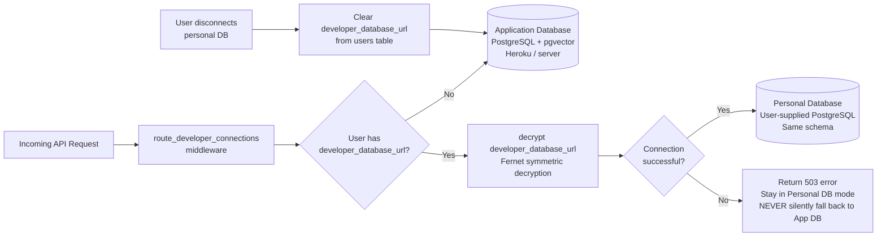
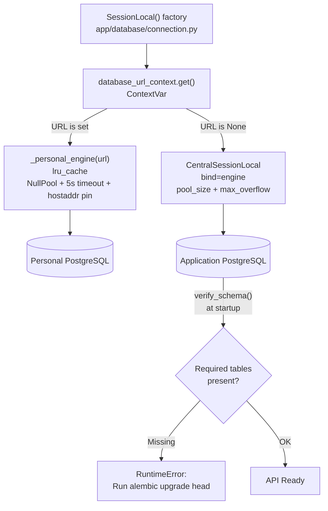
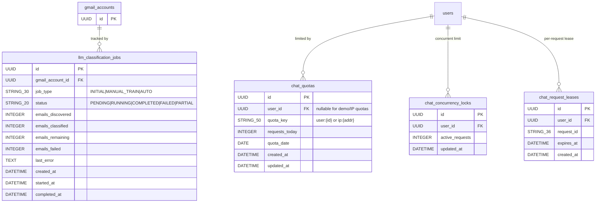

# VC11 — Complete Database ERD

> **Source:** Verified against `app/models/email.py`, `app/models/rag.py`, `app/models/llm.py`, `app/models/chat_quota.py` and all 16 Alembic migrations.

---

## Table of Contents

1. [Two Database Modes](#1-two-database-modes)
2. [Database Connection Logic](#2-database-connection-logic)
3. [Application Database ERD — Core Email Tables](#3-application-database-erd--core-email-tables)
4. [RAG / AI Tables ERD](#4-rag--ai-tables-erd)
5. [LLM & Quota Tables ERD](#5-llm--quota-tables-erd)
6. [Complete Table Reference](#6-complete-table-reference)
7. [Migration History](#7-migration-history)

---

## 1. Two Database Modes



> [!IMPORTANT]
> **Strict failure mode:** When a personal database is configured and the connection fails (timeout, auth error, network), the request fails with an error. The application **never silently falls back** to the Application Database. The user must explicitly disconnect their personal database to return to the Application Database.

### How the Routing Works

1. **Middleware** (`app/api/app.py: route_developer_connections`) runs on every API request.
2. It reads the authenticated session, loads the user from `CentralSessionLocal` (Application DB — always used for identity lookups).
3. It decrypts `user.developer_database_url`. If set, it sets `database_url_context` (a Python `ContextVar`) to the personal URL.
4. `SessionLocal()` in `database/connection.py` reads `database_url_context.get()`. If set, it creates a session against the personal engine. Otherwise, it uses the central `CentralSessionLocal`.
5. The personal engine uses `NullPool` (no connection pooling), 5-second connect timeout, and DNS-resolved `hostaddr` pinning (SSRF protection).

---

## 2. Database Connection Logic



---

## 3. Application Database ERD — Core Email Tables

```mermaid
erDiagram
    users {
        UUID id PK
        STRING_255 google_id UK
        STRING_320 email UK
        STRING_255 name
        STRING_500 picture
        BOOLEAN is_demo
        TEXT developer_database_url "Encrypted (Fernet)"
        STRING_20 developer_llm_provider
        TEXT developer_llm_api_key "Encrypted (Fernet)"
        DATETIME created_at
        DATETIME updated_at
    }

    gmail_accounts {
        UUID id PK
        UUID user_id FK
        STRING_320 email_address UK_with_user_id
        STRING_32 provider "default: gmail"
        STRING_255 gmail_user_id
        TEXT access_token
        TEXT refresh_token
        DATETIME token_expiry
        TEXT scope
        STRING_20 sync_status "IDLE|INITIAL|BACKFILL|ERROR|BACKFILL_ERROR"
        TEXT inbox_sync_page_token
        DATETIME inbox_sync_heartbeat_at
        DATETIME last_synced_at
        STRING_255 history_id
        BOOLEAN ai_classification_enabled
        DATETIME created_at
        DATETIME updated_at
    }

    emails {
        UUID id PK
        UUID gmail_account_id FK
        STRING_255 gmail_message_id UK_with_account
        STRING_255 thread_id
        STRING_320 from_email
        STRING_320 to_email
        TEXT cc
        TEXT bcc
        STRING_255 sender_name
        TEXT subject
        TEXT snippet
        TEXT body
        TEXT body_html
        BOOLEAN is_read
        BOOLEAN is_starred
        BOOLEAN has_attachment
        INTEGER size_estimate
        DATETIME received_at
        DATETIME created_at
        DATETIME updated_at
    }

    labels {
        UUID id PK
        UUID gmail_account_id FK
        STRING_255 label_id UK_with_account "Gmail label ID e.g. INBOX, SENT"
        STRING_255 name
        STRING_50 type "user|system"
        DATETIME created_at
    }

    email_labels {
        UUID id PK
        UUID email_id FK
        UUID label_id FK
        UUID gmail_account_id FK
        DATETIME created_at
    }

    ai_categories {
        UUID id PK
        STRING_100 name UK "WORK|PERSONAL|FINANCE|NEWSLETTERS|PROMOTIONS|SOCIAL|TRAVEL|SHOPPING|HEALTH|LEGAL|EDUCATION|OTHER"
        TEXT description
        DATETIME created_at
    }

    email_classifications {
        UUID id PK
        UUID email_id FK
        UUID category_id FK
        FLOAT confidence_score "0.0–1.0"
        STRING_150 model_name
        STRING_100 model_version
        STRING_100 prompt_version
        STRING_20 classification_status "PENDING|SUCCEEDED|FAILED"
        TEXT classification_reason
        BOOLEAN is_current
        DATETIME classified_at
        DATETIME created_at
        DATETIME updated_at
    }

    sync_history {
        UUID id PK
        UUID gmail_account_id FK
        STRING_30 sync_type "trigger: MANUAL|AUTO|INCREMENTAL"
        STRING_20 status "PENDING|RUNNING|SUCCEEDED|FAILED"
        DATETIME started_at
        DATETIME completed_at
        INTEGER messages_fetched
        INTEGER messages_inserted
        INTEGER messages_updated
        INTEGER labels_synced
        TEXT error_message
        DATETIME created_at
    }

    users ||--o{ gmail_accounts : "has"
    gmail_accounts ||--o{ emails : "owns"
    gmail_accounts ||--o{ labels : "has"
    gmail_accounts ||--o{ sync_history : "tracks"
    emails }o--o{ labels : "via email_labels"
    email_labels }|--|| emails : "tags"
    email_labels }|--|| labels : "uses"
    emails ||--o{ email_classifications : "classified by"
    email_classifications }o--|| ai_categories : "belongs to"
```

---

## 4. RAG / AI Tables ERD

```mermaid
erDiagram
    emails {
        UUID id PK
    }

    email_chunks {
        UUID id PK
        UUID email_id FK
        INTEGER chunk_index
        TEXT chunk_text
        INTEGER start_index
        INTEGER end_index
        STRING_50 chunk_strategy "recursive_character"
        STRING_64 content_hash
        DATETIME created_at
    }

    email_embeddings {
        UUID id PK
        UUID chunk_id FK
        UUID email_id FK
        HALFVEC_3072 embedding "pgvector HALFVEC(3072)"
        TEXT email_subject
        TEXT sender_email
        ARRAY_TEXT recipient_emails
        DATETIME email_sent_at
        TEXT embedding_text "concatenated subject+body chunk"
        STRING_30 embedding_type "email"
        STRING_100 vector_collection "postgres_halfvec_3072"
        STRING_255 vector_record_id UK_with_collection
        STRING_50 embedding_provider "azure_openai"
        STRING_100 embedding_model "text-embedding-3-large"
        INTEGER embedding_dimensions "3072"
        STRING_64 content_hash
        STRING_20 status "PENDING|INDEXED|FAILED|OUTDATED"
        INTEGER index_version
        JSONB metadata_json
        DATETIME indexed_at
        DATETIME created_at
        DATETIME updated_at
    }

    attachments {
        UUID id PK
        UUID email_id FK
        STRING_255 gmail_attachment_id
        STRING_500 filename
        STRING_255 mime_type
        BIGINT file_size_bytes
        TEXT extracted_text
        STRING_20 extraction_status "PENDING|EXTRACTED|FAILED|SKIPPED"
        DATETIME created_at
        DATETIME updated_at
    }

    chat_sessions {
        UUID id PK
        UUID user_id FK
        STRING_255 title
        DATETIME created_at
        DATETIME updated_at
    }

    chat_messages {
        UUID id PK
        UUID chat_session_id FK
        STRING_20 role "user|assistant|system"
        TEXT content
        DATETIME created_at
    }

    chat_retrievals {
        UUID id PK
        UUID chat_session_id FK
        UUID chat_message_id FK
        UUID chunk_id FK
        FLOAT similarity_score
        INTEGER retrieval_rank
        DATETIME created_at
    }

    email_send_approvals {
        UUID id PK
        UUID user_id FK
        STRING_320 recipient_email
        TEXT cc
        TEXT bcc
        TEXT subject
        TEXT draft_body
        STRING_20 status "PENDING|APPROVED|SCHEDULED|SENDING|REJECTED|SENT|CANCELLED"
        DATETIME approved_at
        DATETIME scheduled_for
        DATETIME sent_at
        STRING_255 delivery_message_id
        DATETIME created_at
    }

    emails ||--o{ email_chunks : "split into"
    email_chunks ||--o{ email_embeddings : "vectorised as"
    emails ||--o{ email_embeddings : "directly linked"
    emails ||--o{ attachments : "has"
    users ||--o{ chat_sessions : "owns"
    chat_sessions ||--o{ chat_messages : "contains"
    chat_sessions ||--o{ chat_retrievals : "tracks"
    chat_messages ||--o{ chat_retrievals : "grounded by"
    email_chunks ||--o{ chat_retrievals : "cited in"
    users ||--o{ email_send_approvals : "authorises"
```

### Vector Index Details

| Column | Table | Type | Dimensions | Index |
|---|---|---|---|---|
| `embedding` | `email_embeddings` | `HALFVEC(3072)` | 3072 | IVFFlat or HNSW (pgvector) via Alembic migration |
| Similarity metric | — | cosine (`<=>`) | — | Applied in pgvector SQL queries |

---

## 5. LLM & Quota Tables ERD



---

## 6. Complete Table Reference

### `users`
| Column | Type | Constraint | Notes |
|---|---|---|---|
| `id` | UUID | PK, default=uuid4 | |
| `google_id` | VARCHAR(255) | UNIQUE, NOT NULL | Google OAuth `sub` claim |
| `email` | VARCHAR(320) | UNIQUE, NOT NULL | |
| `name` | VARCHAR(255) | nullable | |
| `picture` | VARCHAR(500) | nullable | Profile image URL |
| `is_demo` | BOOLEAN | NOT NULL, default=false | Demo mailbox flag |
| `developer_database_url` | TEXT | nullable | Fernet-encrypted personal DB URL |
| `developer_llm_provider` | VARCHAR(20) | nullable | `google` or `openai` |
| `developer_llm_api_key` | TEXT | nullable | Fernet-encrypted API key |
| `created_at` | TIMESTAMPTZ | NOT NULL | |
| `updated_at` | TIMESTAMPTZ | NOT NULL | |

### `gmail_accounts`
| Column | Type | Constraint | Notes |
|---|---|---|---|
| `id` | UUID | PK | |
| `user_id` | UUID | FK→users(CASCADE), NOT NULL | |
| `email_address` | VARCHAR(320) | UNIQUE(user_id, email_address) | Physical column name |
| `provider` | VARCHAR(32) | NOT NULL, default='gmail' | |
| `gmail_user_id` | VARCHAR(255) | nullable | Gmail internal user ID |
| `access_token` | TEXT | NOT NULL | Current OAuth access token |
| `refresh_token` | TEXT | nullable | OAuth refresh token |
| `token_expiry` | TIMESTAMPTZ | nullable | |
| `scope` | TEXT | nullable | Granted OAuth scopes |
| `sync_status` | VARCHAR(20) | NOT NULL, default='IDLE' | IDLE\|INITIAL\|BACKFILL\|ERROR\|BACKFILL_ERROR |
| `inbox_sync_page_token` | TEXT | nullable | Gmail pagination cursor |
| `inbox_sync_heartbeat_at` | TIMESTAMPTZ | nullable | Lease timestamp (15min window) |
| `last_synced_at` | TIMESTAMPTZ | nullable | |
| `history_id` | VARCHAR(255) | nullable | Gmail history ID for incremental sync |
| `ai_classification_enabled` | BOOLEAN | NOT NULL, default=false | |
| `created_at` | TIMESTAMPTZ | NOT NULL | |
| `updated_at` | TIMESTAMPTZ | NOT NULL | |

**Indexes:** `ix_gmail_accounts_user_id`, `uq_gmail_accounts_user_email`, `uq_gmail_accounts_id_user`

### `emails`
| Column | Type | Constraint | Notes |
|---|---|---|---|
| `id` | UUID | PK | |
| `gmail_account_id` | UUID | FK→gmail_accounts(CASCADE), NOT NULL | |
| `gmail_message_id` | VARCHAR(255) | UNIQUE(gmail_account_id), NOT NULL | Gmail's message ID |
| `thread_id` | VARCHAR(255) | nullable | Gmail thread ID |
| `from_email` | VARCHAR(320) | nullable | |
| `to_email` | VARCHAR(320) | nullable | |
| `cc` | TEXT | nullable | |
| `bcc` | TEXT | nullable | |
| `sender_name` | VARCHAR(255) | nullable | |
| `subject` | TEXT | nullable | |
| `snippet` | TEXT | nullable | Gmail snippet |
| `body` | TEXT | nullable | Plain text body |
| `body_html` | TEXT | nullable | Raw HTML body |
| `is_read` | BOOLEAN | default=false | |
| `is_starred` | BOOLEAN | default=false | |
| `has_attachment` | BOOLEAN | default=false | |
| `size_estimate` | INTEGER | nullable | Gmail size estimate (bytes) |
| `received_at` | TIMESTAMPTZ | nullable | |
| `created_at` | TIMESTAMPTZ | NOT NULL | |
| `updated_at` | TIMESTAMPTZ | NOT NULL | |

**Indexes:** multiple on `gmail_account_id`, `received_at`, `is_read`, `thread_id`

### `email_chunks`
| Column | Type | Constraint | Notes |
|---|---|---|---|
| `id` | UUID | PK | |
| `email_id` | UUID | FK→emails(CASCADE), NOT NULL | |
| `chunk_index` | INTEGER | NOT NULL, UNIQUE(email_id) | Position in email |
| `chunk_text` | TEXT | NOT NULL | Chunk content |
| `start_index` | INTEGER | nullable | Character offset |
| `end_index` | INTEGER | nullable | Character offset |
| `chunk_strategy` | VARCHAR(50) | NOT NULL, default='recursive_character' | |
| `content_hash` | VARCHAR(64) | NOT NULL | SHA-256 of chunk_text |
| `created_at` | TIMESTAMPTZ | NOT NULL | |

### `email_embeddings`
| Column | Type | Constraint | Notes |
|---|---|---|---|
| `id` | UUID | PK | |
| `chunk_id` | UUID | FK→email_chunks(CASCADE), NOT NULL | |
| `email_id` | UUID | FK→emails(CASCADE), nullable | Denormalised for fast filtering |
| `embedding` | HALFVEC(3072) | nullable | pgvector half-precision vector |
| `email_subject` | TEXT | nullable | Denormalised for metadata filter |
| `sender_email` | TEXT | nullable | Denormalised |
| `recipient_emails` | ARRAY(TEXT) | nullable | Denormalised |
| `email_sent_at` | TIMESTAMPTZ | nullable | Denormalised |
| `embedding_text` | TEXT | nullable | Text that was embedded |
| `embedding_type` | VARCHAR(30) | default='email' | |
| `vector_collection` | VARCHAR(100) | NOT NULL, default='postgres_halfvec_3072' | Namespace |
| `vector_record_id` | VARCHAR(255) | UNIQUE(vector_collection) | |
| `embedding_provider` | VARCHAR(50) | NOT NULL, default='azure_openai' | |
| `embedding_model` | VARCHAR(100) | NOT NULL, default='text-embedding-3-large' | |
| `embedding_dimensions` | INTEGER | NOT NULL, default=3072 | |
| `content_hash` | VARCHAR(64) | NOT NULL | For dedup |
| `status` | VARCHAR(20) | CHECK IN ('PENDING','INDEXED','FAILED','OUTDATED') | |
| `index_version` | INTEGER | nullable | |
| `metadata_json` | JSONB | nullable | Additional filter metadata |
| `indexed_at` | TIMESTAMPTZ | nullable | |
| `created_at` | TIMESTAMPTZ | NOT NULL | |
| `updated_at` | TIMESTAMPTZ | NOT NULL | |

### `email_send_approvals`
| Column | Type | Constraint | Notes |
|---|---|---|---|
| `id` | UUID | PK | |
| `user_id` | UUID | FK→users(CASCADE), NOT NULL | |
| `recipient_email` | VARCHAR(320) | NOT NULL | |
| `cc` | TEXT | nullable | |
| `bcc` | TEXT | nullable | |
| `subject` | TEXT | nullable | |
| `draft_body` | TEXT | NOT NULL | |
| `status` | VARCHAR(20) | CHECK IN ('PENDING','APPROVED','SCHEDULED','SENDING','REJECTED','SENT','CANCELLED') | |
| `approved_at` | TIMESTAMPTZ | nullable | |
| `scheduled_for` | TIMESTAMPTZ | nullable | For scheduled emails |
| `sent_at` | TIMESTAMPTZ | nullable | |
| `delivery_message_id` | VARCHAR(255) | nullable | Gmail delivery ID |
| `created_at` | TIMESTAMPTZ | NOT NULL | |

---

## 7. Migration History

| Migration | File | Description |
|---|---|---|
| 0001 | `20261012_0001_rebuild_gmail_dashboard_schema.py` | Initial schema: users, gmail_accounts, emails, labels, email_labels, ai_categories, email_classifications, sync_history |
| 0002 | `20261013_0002_add_rag_and_chat_tables.py` | RAG tables: email_chunks, email_embeddings (pgvector), attachments, chat_sessions, chat_messages, chat_retrievals, email_send_approvals |
| 0003 | `20261019_0003_heroku_vectors_demo.py` | Heroku pgvector demo config |
| 0004 | `20261023_0004_pgvector_email_metadata.py` | Add denormalised metadata columns to email_embeddings |
| 0005 | `20261024_0005_chat_quotas.py` | Add chat_quotas table |
| 0006 | `20261024_0006_pgvector_metadata_search.py` | pgvector metadata search indexes |
| 0007 | `20261024_0007_dashboard_query_indexes.py` | Performance indexes for dashboard queries |
| 0008 | `20261024_0008_dashboard_classification_lookup.py` | Partial index for current AI classifications |
| 0009 | `20261024_0009_primary_scope_lookup_indexes.py` | Mailbox scope indexes |
| 0010 | `20261024_0010_email_delivery_schedule.py` | Add `scheduled_for` to email_send_approvals |
| 0011 | `20261024_0011_repair_email_delivery_schedule.py` | Fix delivery schedule columns |
| 0012 | `20261024_0012_email_approval_cc_bcc.py` | Add cc, bcc to email_send_approvals |
| 0013 | `20261028_0013_inbox_sync_cursor.py` | Add `inbox_sync_page_token`, `inbox_sync_heartbeat_at` to gmail_accounts |
| 0014 | `20261029_0014_chat_concurrency_limits.py` | Add chat_concurrency_locks, chat_request_leases |
| 0015 | `20261030_0015_vector_column_names.py` | Rename vector column for consistency |
| 0016 | `20261030_0016_developer_settings.py` | Add `developer_database_url`, `developer_llm_provider`, `developer_llm_api_key` to users |
