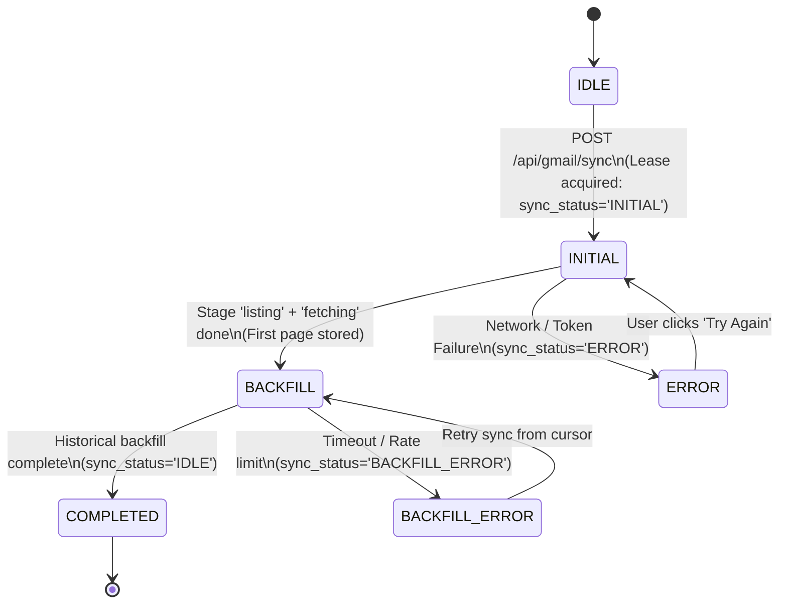
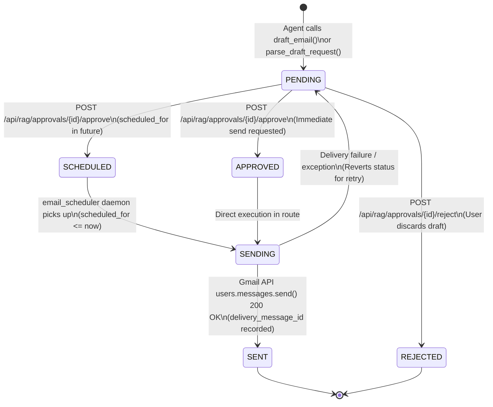
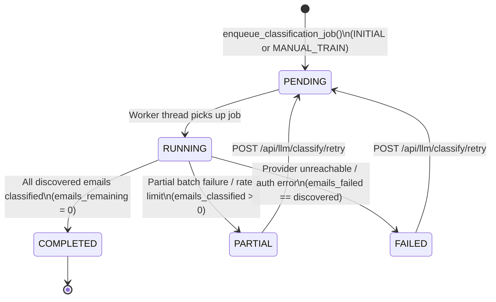
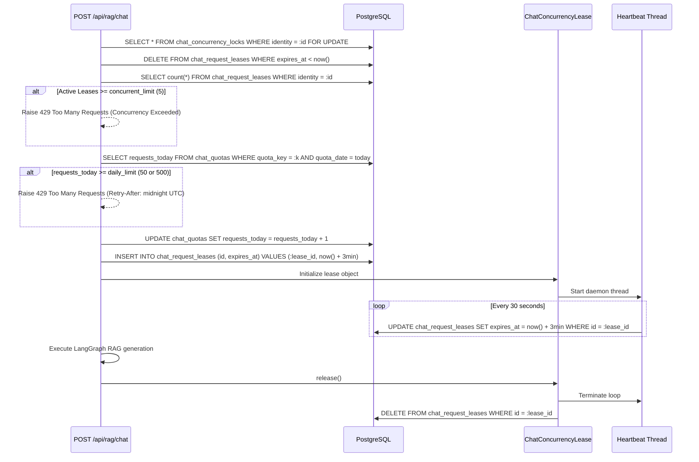
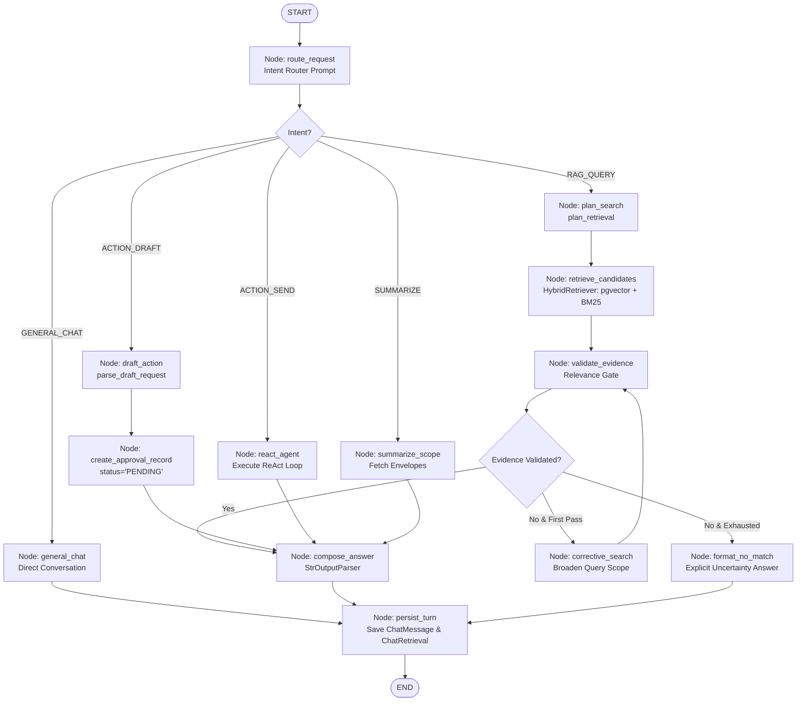
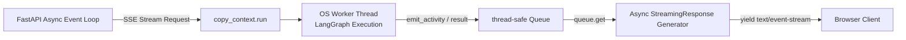

# VC11 — Low-Level System Architecture (LLD)

> **Level:** Low-Level Design (LLD) / Technical Implementation Blueprint  
> **Verification:** Verified directly against backend source code (`app/models/*`, `app/api/*`, `app/services/*`, `app/rag/*`, `app/database/*`), frontend source code (`src/App.jsx`, `src/pages/*`, `src/components/*`, `src/services/api.js`), and all 16 Alembic migrations.

---

## Table of Contents

1. [Low-Level Component & Class Design](#1-low-level-component--class-design)
   - [1.1 SQLAlchemy ORM Domain Entities & Schema Constraints](#11-sqlalchemy-orm-domain-entities--schema-constraints)
   - [1.2 RAG, Agent & Retrieval Class Architecture](#12-rag-agent--retrieval-class-architecture)
   - [1.3 Concurrency, Connection & Daemon Classes](#13-concurrency-connection--daemon-classes)
   - [1.4 Frontend React Component Architecture & Hook State](#14-frontend-react-component-architecture--hook-state)
2. [Low-Level State Machines & Lifecycle Transitions](#2-low-level-state-machines--lifecycle-transitions)
   - [2.1 Mailbox Sync State Machine](#21-mailbox-sync-state-machine)
   - [2.2 Email Send Approval Lifecycle](#22-email-send-approval-lifecycle)
   - [2.3 LLM Categorization Job State Machine](#23-llm-categorization-job-state-machine)
   - [2.4 Chat Concurrency Lease & Quota Lifecycle](#24-chat-concurrency-lease--quota-lifecycle)
   - [2.5 LangGraph Mailbox State Graph Transitions](#25-langgraph-mailbox-state-graph-transitions)
3. [Low-Level Concurrency, Threading & Memory Model](#3-low-level-concurrency-threading--memory-model)
   - [3.1 Threading vs. Asyncio Execution Model](#31-threading-vs-asyncio-execution-model)
   - [3.2 ContextVar Dynamic Database & Key Routing](#32-contextvar-dynamic-database--key-routing)
   - [3.3 Database Engine & Pool Management (`QueuePool` vs. `NullPool`)](#33-database-engine--pool-management-queuepool-vs-nullpool)
   - [3.4 Row-Level Concurrency Locks (`SELECT ... FOR UPDATE`)](#34-row-level-concurrency-locks-select--for-update)
4. [Low-Level Algorithms & Mathematical Formulations](#4-low-level-algorithms--mathematical-formulations)
   - [4.1 BM25 Lexical Ranking Algorithm with Subject Boost](#41-bm25-lexical-ranking-algorithm-with-subject-boost)
   - [4.2 Reciprocal Rank Fusion (RRF) Formulation](#42-reciprocal-rank-fusion-rrf-formulation)
   - [4.3 Vector Cosine Distance & `HALFVEC(3072)` Storage](#43-vector-cosine-distance--halfvec3072-storage)
   - [4.4 Recursive Character Chunking & SHA-256 Hashing](#44-recursive-character-chunking--sha-256-hashing)
5. [Low-Level Wire Protocols, Serialization & Payloads](#5-low-level-wire-protocols-serialization--payloads)
   - [5.1 Server-Sent Events (SSE) Wire Frame Specification](#51-server-sent-events-sse-wire-frame-specification)
   - [5.2 Session Cookie Serialization & Cryptographic Verification](#52-session-cookie-serialization--cryptographic-verification)
   - [5.3 Google OAuth 2.0 PKCE Handshake Payloads](#53-google-oauth-20-pkce-handshake-payloads)
   - [5.4 Gmail API Multipart MIME Decoding Engine](#54-gmail-api-multipart-mime-decoding-engine)
6. [Low-Level Database Queries & Execution Plans](#6-low-level-database-queries--execution-plans)
   - [6.1 Vector Similarity Query with Tenant Scoping](#61-vector-similarity-query-with-tenant-scoping)
   - [6.2 Analytics KPI Summary Query (Correlated EXISTS)](#62-analytics-kpi-summary-query-correlated-exists)
   - [6.3 Optimistic Sync Heartbeat Lease Update](#63-optimistic-sync-heartbeat-lease-update)
   - [6.4 Concurrency Lock Reservation Query](#64-concurrency-lock-reservation-query)

---

## 1. Low-Level Component & Class Design

### 1.1 SQLAlchemy ORM Domain Entities & Schema Constraints

All models inherit from `app.models.email.Base` (`DeclarativeBase`).

```mermaid
classDiagram
    class User {
        +UUID id PK
        +String(255) google_id UK
        +String(320) email UK
        +String(255) name
        +String(500) picture
        +Boolean is_demo
        +Text developer_database_url
        +String(20) developer_llm_provider
        +Text developer_llm_api_key
        +DateTime created_at
        +DateTime updated_at
        +gmail_accounts: list~GmailAccount~
        +chat_sessions: list~ChatSession~
        +send_approvals: list~EmailSendApproval~
    }

    class GmailAccount {
        +UUID id PK
        +UUID user_id FK
        +String(320) email_address
        +String(32) provider
        +String(255) gmail_user_id
        +Text access_token
        +Text refresh_token
        +DateTime token_expiry
        +Text scope
        +String(20) sync_status
        +Text inbox_sync_page_token
        +DateTime inbox_sync_heartbeat_at
        +DateTime last_synced_at
        +String(255) history_id
        +Boolean ai_classification_enabled
        +emails: list~Email~
        +labels: list~Label~
        +sync_history: list~SyncHistory~
    }

    class Email {
        +UUID id PK
        +UUID gmail_account_id FK
        +String(255) gmail_message_id
        +String(255) thread_id
        +String(320) from_email
        +String(320) to_email
        +Text cc
        +Text bcc
        +String(255) sender_name
        +Text subject
        +Text snippet
        +Text body
        +Text body_html
        +Boolean is_read
        +Boolean is_starred
        +Boolean has_attachment
        +Integer size_estimate
        +DateTime received_at
        +chunks: list~EmailChunk~
        +classifications: list~EmailClassification~
        +attachments: list~Attachment~
    }

    class EmailChunk {
        +UUID id PK
        +UUID email_id FK
        +Integer chunk_index
        +Text chunk_text
        +Integer start_index
        +Integer end_index
        +String(50) chunk_strategy
        +String(64) content_hash
        +DateTime created_at
        +embeddings: list~EmailEmbedding~
        +chat_retrievals: list~ChatRetrieval~
    }

    class EmailEmbedding {
        +UUID id PK
        +UUID chunk_id FK
        +UUID email_id FK
        +HALFVEC(3072) embedding
        +Text email_subject
        +Text sender_email
        +ARRAY(Text) recipient_emails
        +DateTime email_sent_at
        +Text embedding_text
        +String(30) embedding_type
        +String(100) vector_collection
        +String(255) vector_record_id UK
        +String(50) embedding_provider
        +String(100) embedding_model
        +Integer embedding_dimensions
        +String(64) content_hash
        +String(20) status
        +JSONB metadata_json
    }

    class EmailSendApproval {
        +UUID id PK
        +UUID user_id FK
        +String(320) recipient_email
        +Text cc
        +Text bcc
        +Text subject
        +Text draft_body
        +String(20) status
        +DateTime approved_at
        +DateTime scheduled_for
        +DateTime sent_at
        +String(255) delivery_message_id
    }

    User "1" --> "*" GmailAccount : owns
    GmailAccount "1" --> "*" Email : stores
    Email "1" --> "*" EmailChunk : split into
    EmailChunk "1" --> "*" EmailEmbedding : indexed by
    User "1" --> "*" EmailSendApproval : authorizes
```



#### Exact Column Definitions & Foreign Key Constraints:
- `users`: Primary key `id: UUID` (default `uuid4`). Unique constraint on `google_id` and `email`.
- `gmail_accounts`: Unique constraint `uq_gmail_accounts_user_email` on `(user_id, email_address)`. Unique constraint `uq_gmail_accounts_id_user` on `(id, user_id)` (used for composite foreign key references). Index on `user_id`.
- `emails`: Unique constraint `uq_emails_account_message` on `(gmail_account_id, gmail_message_id)`. Partial indexes for inbox/unread status queries.
- `email_chunks`: Unique constraint `uq_email_chunks_email_index` on `(email_id, chunk_index)`. Index on `content_hash` for deduplication.
- `email_embeddings`: Unique constraint `uq_email_embeddings_collection_record` on `(vector_collection, vector_record_id)`. Check constraint `ck_email_embeddings_status` enforcing `status IN ('PENDING', 'INDEXED', 'FAILED', 'OUTDATED')`.
- `email_send_approvals`: Check constraint `ck_email_send_approvals_status` enforcing `status IN ('PENDING', 'APPROVED', 'SCHEDULED', 'SENDING', 'REJECTED', 'SENT', 'CANCELLED')`.

---

### 1.2 RAG, Agent & Retrieval Class Architecture

*Source files:* `app/rag/graph_agent.py`, `app/rag/agent.py`, `app/rag/chains.py`, `app/rag/adaptive.py`, `app/rag/retrieval.py`

#### A. `MailboxState` (TypedDict)
Tracks graph execution memory across nodes in LangGraph:
```python
class MailboxState(TypedDict, total=False):
    query: str                      # Raw user query
    effective_query: str            # Rewritten standalone query
    intent: str                     # Intent enum: RAG_QUERY, ACTION_DRAFT, etc.
    messages: list[Any]             # Conversational messages
    answer: str                     # Final generated answer text
    iterations: int                 # ReAct loop counter (max 5)
    steps: list[dict[str, Any]]     # Observable telemetry steps
    approval_id: str | None         # UUID of created EmailSendApproval
    plan: list[str]                 # Sequential sub-tasks for Plan-and-Execute
    search_plan: dict[str, Any]     # Output of plan_retrieval()
    evidence_validated: bool        # Whether evidence passed relevance check
    interpreted_draft: dict[str, Any] | None
    clarification_question: str | None
    grounded_answer_ready: bool
```

#### B. `RetrievalPlan` (Dataclass)
*File:* `app/rag/adaptive.py`
```python
@dataclass
class RetrievalPlan:
    strategy: str               # "vector", "bm25", "multi_query", "mmr", "exhaustive_mailbox", "structured"
    exhaustive: bool           # True for "all/every" queries
    date_only: bool            # True for pure date-range summaries (skips semantic relevance gate)
    multi_query: bool          # True for complex compound analytical questions
    diverse: bool              # True for overview / thematic questions
    label: str                 # Human-readable execution description
    date_start: str | None     # ISO start bound
    date_end: str | None       # ISO end bound
    providers: list[str]       # ["vector", "bm25", "gmail_mcp"]
    routing_reason: str        # Explanation string returned to frontend
```

#### C. `RetrievedCitation` (Dataclass)
*File:* `app/rag/retrieval.py`
```python
@dataclass
class RetrievedCitation:
    email_id: str
    subject: str
    sender: str
    date: str
    snippet: str
    score: float
    key_points: list[str] = field(default_factory=list)
```

#### D. `AgentResponse` (Dataclass)
*File:* `app/rag/agent.py`
```python
@dataclass
class AgentResponse:
    answer: str
    intent: str
    citations: list[RetrievedCitation]
    steps: list[dict[str, Any]]
    plan: list[str] | None = None
    search_plan: dict[str, Any] | None = None
    approval_required: bool = False
    approval_id: str | None = None
    approval_preview: dict[str, Any] | None = None
    session_id: str = ""
    message_id: str = ""
```

---

### 1.3 Concurrency, Connection & Daemon Classes

#### A. `ChatConcurrencyLease`
*File:* `app/services/chat_quota.py`
- Implements background heartbeat thread (`_heartbeat`) running every 30 seconds.
- Updates `chat_request_leases.expires_at = utcnow() + 3 minutes`.
- Method `release()`: Cancels heartbeat event and issues `DELETE FROM chat_request_leases WHERE id = :lease_id`.

#### B. Connection Management & Factory Functions
*File:* `app/database/connection.py`
- `engine`: Created with `create_engine(settings.database_url, pool_size=5, max_overflow=10, pool_pre_ping=True)`.
- `CentralSessionLocal`: `sessionmaker(bind=engine, autoflush=False, autocommit=False)`.
- `_personal_engine(url: str)`: Decorated with `@lru_cache(maxsize=32)`. Creates engine with `poolclass=NullPool`, `connect_args={"connect_timeout": 5, "hostaddr": pinned_ip}`.
- `SessionLocal()`: Evaluates `database_url_context.get()`. If set, yields session bound to `_personal_engine(url)`; otherwise yields `CentralSessionLocal()`.

---

### 1.4 Frontend React Component Architecture & Hook State

#### A. `App.jsx` Dashboard State Architecture
- `[active, setActive]`: Active tab (`Dashboard`, `Inbox`, `Sent`, `Starred`, `Important`, `Drafts`, `Spam`, `Trash`).
- `[search, setSearch]`: Search input value (triggers filtered email querying).
- `[selectedId, setSelectedId]`: UUID of currently selected email for preview panel.
- `[selectedIds, setSelectedIds]`: `Set<string>` of selected emails for bulk operations.
- `[range, setRange]`: Time range key for summary KPI cards (default: `'all_time'`).
- `[activityRange, setActivityRange]`: Time range key for incoming/outgoing LineChart.
- `[previewEmail, setPreviewEmail]`: Full email object populated on click and hydrated via `fetchEmail(id)`.
- `[composeOpen, setComposeOpen]`: Boolean toggle for `ComposeModal`.
- `[composeData, setComposeData]`: Pre-filled recipient, subject, and body when replying or forwarding.

#### B. `AiAssistant.jsx` Chat State Machine
- `[messages, setMessages]`: Array of `{ id, role, content, citations, steps, approval_id, approval_preview }`.
- `[input, setInput]`: Textarea value.
- `[isTyping, setIsTyping]`: Boolean showing live typing indicator.
- `[activitySteps, setActivitySteps]`: Array of observable tool activities received over SSE.
- `[draftReview, setDraftReview]`: Holds approval draft currently open in the edit modal (`id`, `recipient_email`, `cc`, `bcc`, `subject`, `draft_body`).
- `[sessionId, setSessionId]`: UUID of current chat thread.

---

## 2. Low-Level State Machines & Lifecycle Transitions

### 2.1 Mailbox Sync State Machine
*Database column:* `gmail_accounts.sync_status`



- **Heartbeat Lock:** `inbox_sync_heartbeat_at` is set to `utcnow()`. Leases expire after 15 minutes (`_SYNC_LEASE = timedelta(minutes=15)`). If an instance crashes mid-sync, another process can acquire the lease once stale.

---

### 2.2 Email Send Approval Lifecycle
*Database column:* `email_send_approvals.status`



---

### 2.3 LLM Categorization Job State Machine
*Database column:* `llm_classification_jobs.status`



---

### 2.4 Chat Concurrency Lease & Quota Lifecycle



---

### 2.5 LangGraph Mailbox State Graph Transitions



---

## 3. Low-Level Concurrency, Threading & Memory Model

### 3.1 Threading vs. Asyncio Execution Model

VC11 runs within **FastAPI / Starlette** on the Uvicorn ASGI event loop, but coordinates background threads for blocking external I/O:

| Operation | Execution Model | Concurrency Isolation |
|---|---|---|
| HTTP Route Handlers | `async def` or `def` (Threadpool) | Executed in Starlette threadpool; database sessions closed in `finally`. |
| SSE Chat Stream (`/api/rag/chat/stream`) | Python `threading.Thread` + `Queue` | Worker thread runs in separate OS thread; pushes events to `Queue`; async generator pulls from queue and yields SSE frames. |
| Gmail Sync (`/api/gmail/sync`) | Background Daemon Thread | Spawns `threading.Thread(target=..., daemon=True)` via `contextvars.copy_context().run()`. |
| Scheduled Email Delivery | In-Process Daemon (`email_scheduler.py`) | Thread-safe singleton (`_worker_lock`) running a 15-second loop. |
| AI Classifier Daemon | In-Process Daemon (`llm_classification_service.py`) | Thread-safe singleton running a 30-second loop. |
| RAG Auto-Indexer Daemon | In-Process Daemon (`rag_auto_indexer.py`) | Thread-safe singleton running a 30-second loop. |



---

### 3.2 ContextVar Dynamic Database & Key Routing
*File:* `app/services/developer_settings.py`

VC11 achieves multi-tenant database isolation without server restarts via Python's standard `contextvars`:
```python
database_url_context: ContextVar[str | None] = ContextVar("database_url_context", default=None)
llm_key_context: ContextVar[tuple[str, str] | None] = ContextVar("llm_key_context", default=None)
```

1. **Middleware Scope (`app/api/app.py`):** On incoming requests, `route_developer_connections` checks user credentials.
2. **Context Binding:** If `developer_database_url` exists, it sets `database_url_context.set(decrypted_url)`.
3. **Session Instantiation:** When any route or service calls `SessionLocal()`, it reads `database_url_context.get()`.
4. **Thread Propagation:** When spawning background worker threads, `contextvars.copy_context().run(...)` is explicitly used so the worker thread inherits the exact same database context as the initiating HTTP request.

---

### 3.3 Database Engine & Pool Management (`QueuePool` vs. `NullPool`)

```mermaid
flowchart TD
    CALLER[Code invokes SessionLocal] --> GET_CTX{database_url_context.get?}
    
    GET_CTX -->|None| CENTRAL[Use Central Application DB]
    CENTRAL --> QUEUE_POOL[QueuePool\npool_size=5, max_overflow=10\npool_pre_ping=True]
    
    GET_CTX -->|URL String| PERSONAL[Use Personal DB Engine]
    PERSONAL --> LRU_CACHE[@lru_cache maxsize=32\n_personal_engine url]
    LRU_CACHE --> NULL_POOL[NullPool\nZero connection pooling\nconnect_timeout=5\nhostaddr=pinned_ip]
```

- **Why `NullPool` for Personal Databases?** Avoids maintaining idle connections to untrusted, remote, or ephemeral user-supplied database servers. Every session opens a fresh TCP socket with a strict 5-second timeout and closes it immediately upon session teardown.
- **SSRF Prevention:** `get_pinned_hostaddr(url)` resolves the hostname via DNS once during connection setup, rejects private IP subnets (`127.0.0.1`, `10.0.0.0/8`, `192.168.0.0/16`, `169.254.169.254`), and passes the resolved IP directly via `connect_args["hostaddr"]`.

---

### 3.4 Row-Level Concurrency Locks (`SELECT ... FOR UPDATE`)

To prevent race conditions during concurrent user prompts:
```sql
SELECT id, active_requests 
FROM chat_concurrency_locks 
WHERE identity = :identity 
FOR UPDATE;
```
This forces concurrent chat requests from the same user to queue sequentially at the database row level, preventing race conditions when evaluating the 5-request concurrency ceiling or daily quota counts.

---

## 4. Low-Level Algorithms & Mathematical Formulations

### 4.1 BM25 Lexical Ranking Algorithm with Subject Boost
*File:* `app/rag/adaptive.py:bm25_rank`

VC11 implements Okapi BM25 scoring with a **$3\times$ subject frequency multiplier**:

$$\text{Tokens}(D) = \text{SubjectTokens}(D) \times 3 + \text{BodyTokens}(D)$$

Given query terms $Q = \{q_1, q_2, \dots, q_n\}$, document collection $C$ with $N = |C|$, and average document token length $\text{avgdl}$:

#### 1. Inverse Document Frequency (IDF):
$$\text{IDF}(q_i) = \ln\left(1 + \frac{N - n(q_i) + 0.5}{n(q_i) + 0.5}\right)$$
where $n(q_i)$ is the number of documents in $C$ containing term $q_i$.

#### 2. Term Score Computation ($k_1 = 1.5, b = 0.75$):
$$\text{Score}(D, Q) = \sum_{q_i \in Q} \text{IDF}(q_i) \cdot \frac{f(q_i, D) \cdot (k_1 + 1)}{f(q_i, D) + k_1 \cdot \left(1 - b + b \cdot \frac{|D|}{\text{avgdl}}\right)}$$
$$= \sum_{q_i \in Q} \text{IDF}(q_i) \cdot \frac{f(q_i, D) \cdot 2.5}{f(q_i, D) + 1.5 \cdot \left(0.25 + 0.75 \cdot \frac{|D|}{\text{avgdl}}\right)}$$

#### 3. Score Normalization:
$$\text{NormalizedScore}(D) = \frac{\text{Score}(D, Q)}{\max_{D' \in C} \text{Score}(D', Q)}$$
This normalizes BM25 scores into the $[0.0, 1.0]$ range, making them directly comparable with cosine similarity scores.

---

### 4.2 Reciprocal Rank Fusion (RRF) Formulation
*File:* `app/rag/adaptive.py:fuse_rankings`

When combining rankings from the dense vector retriever ($R_{\text{dense}}$) and the sparse BM25 retriever ($R_{\text{sparse}}$):

$$\text{RRF\_Score}(d) = \sum_{m \in \{R_{\text{dense}}, R_{\text{sparse}}\}} \frac{1}{k + r_m(d)}$$
where $k = 60$ (smoothing constant) and $r_m(d) \in [1, 2, \dots]$ is the 1-based rank position of email $d$ in system $m$. If an email has multiple chunks in the same ranking list, it receives **at most one vote per ranking system**.

---

### 4.3 Vector Cosine Distance & `HALFVEC(3072)` Storage

- **Embedding Model:** Azure OpenAI `text-embedding-3-large`.
- **Dimensions:** 3072.
- **Precision:** 16-bit half-precision floating point (IEEE 754 binary16).
- **Cosine Distance Equation (SQL `<=>` operator):**
$$\text{CosineDistance}(\vec{u}, \vec{v}) = 1 - \frac{\sum_{i=1}^{3072} u_i \cdot v_i}{\sqrt{\sum_{i=1}^{3072} u_i^2} \cdot \sqrt{\sum_{i=1}^{3072} v_i^2}}$$

In `pgvector`, vectors produced by `text-embedding-3-large` are unit-normalized ($\|\vec{u}\|_2 = 1$), meaning:
$$\text{CosineDistance}(\vec{u}, \vec{v}) = 1 - (\vec{u} \cdot \vec{v})$$
Cosine similarity is therefore computed as:
$$\text{Similarity}(\vec{u}, \vec{v}) = 1.0 - \text{distance}$$

---

### 4.4 Recursive Character Chunking & SHA-256 Hashing

1. **Hierarchy of Delimiters:** `["\n\n", "\n", ". ", " ", ""]`
2. **Parameters:** `chunk_size = 1000`, `chunk_overlap = 150`.
3. **Content Hash Generation:**
$$\text{content\_hash} = \text{SHA-256}(\text{UTF-8}(\text{chunk\_text}))$$
```python
content_hash = hashlib.sha256(chunk_text.encode("utf-8")).hexdigest()
```
Stored in `email_chunks.content_hash` and indexed with `ix_email_chunks_content_hash`.

---

## 5. Low-Level Wire Protocols, Serialization & Payloads

### 5.1 Server-Sent Events (SSE) Wire Frame Specification

#### A. `/api/rag/chat/stream` Frame Formats
1. **Activity Progress Event:**
   ```http
   event: activity
   data: {"action": "retrieve_candidates", "label": "Searching indexed vector embeddings", "status": "running", "elapsed_ms": 340}

   ```
2. **Warning / Fallback Event:**
   ```http
   event: activity
   data: {"action": "gmail_search", "label": "Live Gmail search unavailable; falling back to local index", "status": "warning", "elapsed_ms": 1250}

   ```
3. **Keepalive Ping (Every 15 Seconds):**
   ```http
   : keepalive

   ```
4. **Final Result Event:**
   ```http
   event: result
   data: {"answer": "You have 2 scheduled interviews...", "intent": "RAG_QUERY", "citations": [...], "steps": [...], "session_id": "...", "message_id": "..."}

   ```

#### B. `/api/gmail/sync/stream` Frame Formats
```http
data: {"status": "syncing", "stage": "fetching", "emails_found": 500, "emails_synced": 340, "labels_synced": 12, "background_status": "idle", "error": null}

```

---

### 5.2 Session Cookie Serialization & Cryptographic Verification
*File:* `backend/app/core/security.py`

- **Cookie Name:** `gmail_ai_session`
- **Wire Structure:** `<encoded_payload>.<hex_signature>`
- **Payload Construction:**
  ```python
  payload = json.dumps({"user_id": str(user.id), "exp": int((utcnow() + lifetime).timestamp())}, separators=(",", ":")).encode()
  encoded = base64.urlsafe_b64encode(payload).decode().rstrip("=")
  ```
- **Signature Construction:**
  ```python
  signature = hmac.new(settings.session_secret.encode(), encoded.encode(), hashlib.sha256).hexdigest()
  cookie_value = f"{encoded}.{signature}"
  ```
- **Verification Algorithm:**
  1. Splits cookie on last `.` character.
  2. Recomputes expected HMAC-SHA256 signature using `settings.session_secret`.
  3. Executes constant-time comparison: `hmac.compare_digest(signature, expected_sig)`.
  4. Decodes base64url JSON, verifies `exp > time.time()`.

---

### 5.3 Google OAuth 2.0 PKCE Handshake Payloads

1. **Authorization URL Initiation (`GET /api/auth/google`):**
   - Generates 32-byte cryptographically secure random `state`: `secrets.token_urlsafe(32)`.
   - Generates 64-byte `code_verifier` and derives `code_challenge`:
     $$\text{code\_challenge} = \text{base64url}(\text{SHA-256}(\text{code\_verifier}))$$
   - Stores `state` in cookie `gmail_ai_oauth_state` (Max-Age: 600s, HttpOnly).
   - Stores `code_verifier` in cookie `gmail_ai_oauth_verifier` (Max-Age: 600s, HttpOnly).
2. **Authorization Callback (`GET /api/auth/callback`):**
   - Validates `request.cookies[STATE_COOKIE] == query_params["state"]`.
   - Posts authorization code and `code_verifier` to Google token endpoint:
     ```http
     POST /token HTTP/1.1
     Host: oauth2.googleapis.com
     Content-Type: application/x-www-form-urlencoded

     code=4/0AfgeX...&client_id=...&client_secret=...&redirect_uri=http://localhost:8000/api/auth/callback&grant_type=authorization_code&code_verifier=...
     ```

---

### 5.4 Gmail API Multipart MIME Decoding Engine
*File:* `backend/app/services/get_mail.py` and `gmail_service.py`

When fetching message payloads with `format="full"`:
1. **Recursive Multipart Tree Walk:** Traverses `payload["parts"]`.
2. **MIME Type Priority:**
   - Detects `text/plain` $\rightarrow$ decodes using URL-safe base64: `base64.urlsafe_b64decode(part["body"]["data"])`.
   - Detects `text/html` $\rightarrow$ saves raw HTML in `body_html` and strips with BeautifulSoup to create plaintext fallback.
   - Detects `filename != ""` $\rightarrow$ creates `Attachment` record storing `file_size_bytes` and `gmail_attachment_id`.

---

## 6. Low-Level Database Queries & Execution Plans

### 6.1 Vector Similarity Query with Tenant Scoping
```sql
SELECT 
    c.id AS chunk_id,
    c.chunk_text,
    c.email_id,
    e.subject,
    e.from_email,
    e.received_at,
    (emb.embedding <=> :query_embedding) AS distance
FROM email_embeddings emb
JOIN email_chunks c ON c.id = emb.chunk_id
JOIN emails e ON e.id = c.email_id
JOIN gmail_accounts ga ON ga.id = e.gmail_account_id
WHERE ga.user_id = :user_id
  AND emb.status = 'INDEXED'
ORDER BY emb.embedding <=> :query_embedding ASC
LIMIT :limit;
```
*Index Used:* `ix_email_embeddings_status`, IVFFlat / HNSW cosine index on `emb.embedding`.

---

### 6.2 Analytics KPI Summary Query (Correlated EXISTS)
*File:* `app/api/routes/emails.py:_count_metrics`

Computes all 4 dashboard KPI metrics in a single database pass:
```sql
SELECT 
    COUNT(e.id) AS total,
    COUNT(CASE WHEN EXISTS (
        SELECT 1 FROM email_classifications ec 
        WHERE ec.email_id = e.id AND ec.is_current = true
    ) THEN 1 END) AS auto_labeled,
    COUNT(CASE WHEN EXISTS (
        SELECT 1 FROM email_labels el 
        JOIN labels l ON l.id = el.label_id 
        WHERE el.email_id = e.id AND l.label_id = 'IMPORTANT'
    ) THEN 1 END) AS important,
    COUNT(CASE WHEN e.is_read = false THEN 1 END) AS unread
FROM emails e
WHERE e.gmail_account_id = :account_id
  AND e.received_at >= :start_at
  AND e.received_at < :end_at;
```
*Index Used:* `ix_email_classifications_dashboard_lookup` (partial index `WHERE is_current = true AND classification_status = 'SUCCEEDED'`).

---

### 6.3 Optimistic Sync Heartbeat Lease Update
*File:* `app/api/routes/gmail.py:start_sync`

```sql
UPDATE gmail_accounts
SET sync_status = 'INITIAL',
    inbox_sync_heartbeat_at = :now
WHERE id = :account_id
  AND (
      sync_status NOT IN ('INITIAL', 'BACKFILL')
      OR inbox_sync_heartbeat_at < :stale_before
      OR inbox_sync_heartbeat_at IS NULL
  );
```
Returns `rowcount`. If `0`, another worker currently holds an active lease; the request terminates gracefully.

---

### 6.4 Concurrency Lock Reservation Query
*File:* `app/services/chat_quota.py:reserve_chat_request`

```sql
-- 1. Acquire row lock
SELECT id, active_requests 
FROM chat_concurrency_locks 
WHERE identity = :identity 
FOR UPDATE;

-- 2. Purge expired leases
DELETE FROM chat_request_leases 
WHERE identity = :identity 
  AND expires_at < :now;

-- 3. Check active concurrent count
SELECT count(id) 
FROM chat_request_leases 
WHERE identity = :identity;

-- 4. Check & increment daily usage
INSERT INTO chat_quotas (id, user_id, quota_key, requests_today, quota_date, created_at, updated_at)
VALUES (:id, :user_id, :quota_key, 1, :today, :now, :now)
ON CONFLICT (quota_key, quota_date)
DO UPDATE SET requests_today = chat_quotas.requests_today + 1, updated_at = :now
RETURNING requests_today;
```
