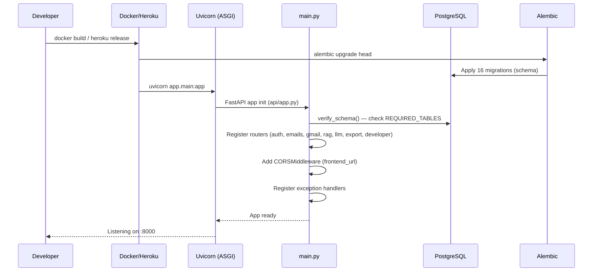
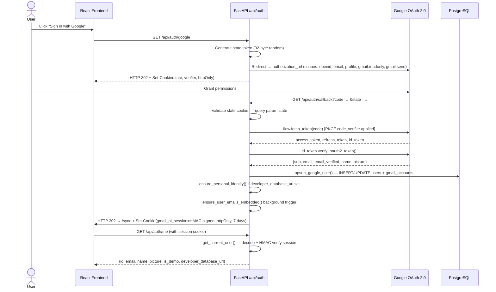
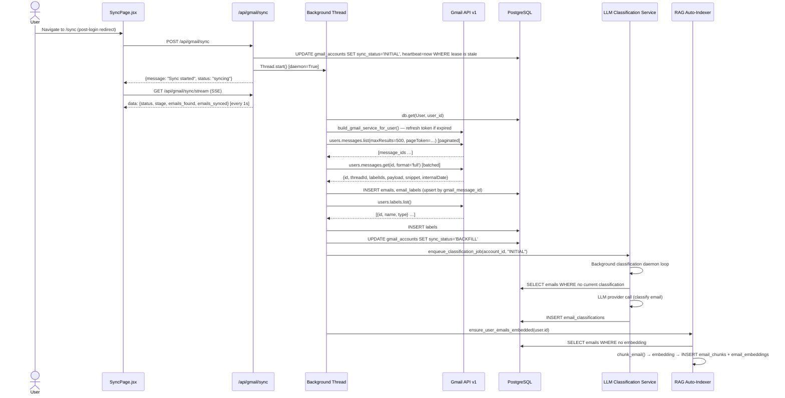
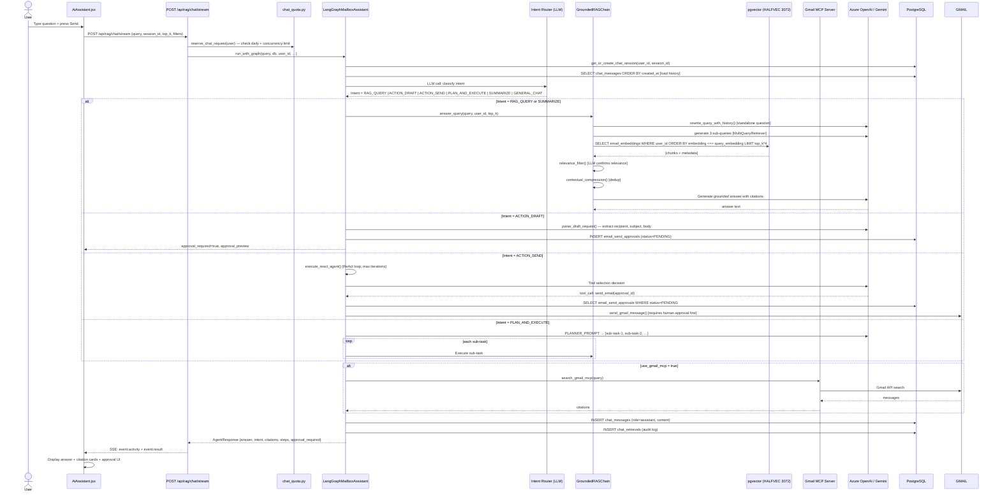
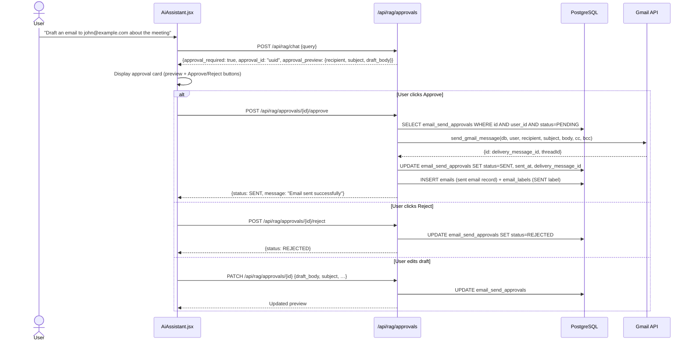

# VC11 — Master Architecture Document

> **Inspection date:** 2026-10-31 | **Status:** Verified against source code

---

## Table of Contents

1. [Project Overview](#1-project-overview)
2. [Technology Stack](#2-technology-stack)
3. [Master System Diagram](#3-master-system-diagram)
4. [Complete Execution Flows](#4-complete-execution-flows)
   - [4.1 Application Startup](#41-application-startup)
   - [4.2 User Authentication Flow](#42-user-authentication-flow)
   - [4.3 Gmail Sync Flow](#43-gmail-sync-flow)
   - [4.4 AI Assistant Chat Flow](#44-ai-assistant-chat-flow)
   - [4.5 Email Send & Approval Flow](#45-email-send--approval-flow)
5. [Database Architecture Summary](#5-database-architecture-summary)
6. [AI / RAG Summary](#6-ai--rag-summary)
7. [MCP Summary](#7-mcp-summary)
8. [Security Summary](#8-security-summary)
9. [Deployment Summary](#9-deployment-summary)
10. [Implementation Status](#10-implementation-status)
11. [Related Documents](#11-related-documents)

---

## 1. Project Overview

**VC11** (product name: **Gmail AI Dashboard**) is a full-stack web application that connects to a user's Gmail account, synchronises emails into a PostgreSQL database, and provides an AI-powered inbox assistant capable of answering natural-language questions, drafting emails, scheduling delivery, and executing Gmail actions — all grounded in retrieved email context using RAG (Retrieval-Augmented Generation).

Key capabilities:

| Capability | Status |
|---|---|
| Google OAuth 2.0 login (Gmail scopes) | ✅ Implemented |
| Inbox email synchronisation (initial + incremental) | ✅ Implemented |
| Email labelling & AI categorisation | ✅ Implemented |
| Analytics dashboard (charts, summaries) | ✅ Implemented |
| Export (CSV / JSON) and Import | ✅ Implemented |
| pgvector embedding pipeline (RAG indexing) | ✅ Implemented |
| AI inbox assistant (LangGraph multi-agent) | ✅ Implemented |
| 10 agent patterns (RAG, ReAct, Router, Plan-and-Execute, Human-in-the-Loop, …) | ✅ Implemented |
| Gmail MCP live-search tool | ✅ Implemented |
| Email draft, schedule, and send (with human approval) | ✅ Implemented |
| Developer personal database support | ✅ Implemented |
| Demo mailbox (seeded, read-only) | ✅ Implemented |
| LangSmith observability tracing | ✅ Implemented |
| LangGraph graph checkpointing (Postgres/SQLite/Memory) | ✅ Implemented |

---

## 2. Technology Stack

### Frontend

| Layer | Technology |
|---|---|
| Framework | React 18 (Vite) |
| Routing | React Router v6 |
| HTTP client | Axios + native `fetch` (SSE streaming) |
| State | `useState`, `useContext` (AuthContext) |
| Styling | CSS modules + Tailwind-compatible classes |
| Build/Dev server | Vite |

### Backend

| Layer | Technology |
|---|---|
| Web framework | FastAPI (Python 3.12+) |
| ASGI server | Uvicorn |
| ORM | SQLAlchemy 2.x (mapped columns) |
| Schema migrations | Alembic (16 versioned migrations) |
| Authentication | Custom HMAC-signed session cookie |
| Google OAuth | `google-auth-oauthlib`, `google-auth` |
| Gmail API | `google-api-python-client` |
| Background jobs | Python `threading.Thread` (daemon) |
| Scheduling | `APScheduler` (email delivery scheduler) |

### AI / LLM Layer

| Layer | Technology |
|---|---|
| Orchestration | LangGraph (`StateGraph` + `SqliteSaver`/`PostgresSaver`) |
| Chain primitives | LangChain Core (`ChatPromptTemplate`, `StrOutputParser`) |
| LLM providers | Azure OpenAI, OpenAI, Google Gemini, NVIDIA NIM, ExplLabs |
| Embedding providers | Azure OpenAI (`text-embedding-3-large`, 3072-dim `HALFVEC`) |
| Vector store | PostgreSQL + pgvector (`HALFVEC(3072)`) |
| Tracing | LangSmith |
| Agent pattern | LangGraph `StateGraph` (primary), LangChain ReAct (fallback) |

### Database

| Component | Technology |
|---|---|
| Primary DB | PostgreSQL + pgvector extension |
| Personal DB | User-supplied PostgreSQL (same schema) |
| Vector storage | `HALFVEC(3072)` columns in `email_embeddings` table |
| Checkpointing | `langgraph.sqlite` (SQLite, or PostgreSQL `PostgresSaver`) |

### Infrastructure

| Component | Technology |
|---|---|
| Containerisation | Docker (`Dockerfile` at repo root) |
| PaaS deployment | Heroku (`heroku.yml`, `DEPLOY_HEROKU.md`) |
| Environment config | `.env` file parsed by `pydantic-settings` |
| CORS | FastAPI `CORSMiddleware` |

---

## 3. Master System Diagram

```mermaid
flowchart TB
    subgraph USER["👤 User Layer"]
        U[Browser]
    end

    subgraph FE["🖥️ Frontend Layer — React / Vite"]
        direction TB
        APP[App.jsx\nRouter + AuthContext]
        PUB[PublicPages.jsx\n/login]
        CONSENT[GmailConsent.jsx\n/consent]
        SYNC[SyncPage.jsx\n/sync]
        INBOX[Inbox\n/dashboard]
        AI[AiAssistant.jsx\n/ai-assistant]
        COMPOSE[ComposeModal.jsx]
        DETAIL[EmailDetailsModal.jsx]
        SENT[SentMessagesView.jsx]
        ACTIVITY[SearchActivity.jsx]
        APIJS[services/api.js\nAxios + SSE client]
    end

    subgraph API_LAYER["🔌 API Communication Layer"]
        CORS_MW[CORS Middleware\nfrontend_url origin]
        SESSION_MW[Session Cookie\nHMAC-SHA256]
    end

    subgraph AUTH["🔐 Authentication Layer"]
        OAUTH_ROUTE["GET /api/auth/google\n→ Google OAuth redirect"]
        CALLBACK["GET /api/auth/callback\n→ Token exchange + session cookie"]
        ME["GET /api/auth/me\n→ Validate session"]
        DEMO["POST /api/auth/demo\n→ Demo user login"]
        LOGOUT["POST /api/auth/logout"]
        ERASE["DELETE /api/auth/erase"]
    end

    subgraph BACKEND["⚙️ Backend Layer — FastAPI"]
        direction TB
        MAIN[main.py\nFastAPI app init]
        EMAIL_R[/api/emails\n/api/analytics\n/api/labels\nemails.py router]
        GMAIL_R[/api/gmail/sync\n/api/gmail/sync/status\n/api/gmail/sync/stream\ngmail.py router]
        RAG_R[/api/rag/chat\n/api/rag/chat/stream\n/api/rag/sessions\n/api/rag/approvals\nrag.py router]
        LLM_R[/api/llm/preference\n/api/llm/classify\nllm.py router]
        EXPORT_R[/api/export/csv\n/api/export/json\nexport.py router]
        DEV_R[/api/developer\ndeveloper.py router]
    end

    subgraph BIZ["🧠 Business Logic Layer"]
        direction LR
        GMAIL_SVC[gmail_service.py\nGmail API calls]
        EMAIL_SVC[email_service.py\nEmail CRUD]
        RAG_IDX[rag_indexer.py\nEmbedding pipeline]
        RAG_AUTO[rag_auto_indexer.py\nBackground auto-index]
        LLM_CLASS[llm_classification_service.py\nAI categorisation]
        EMAIL_SCHED[email_scheduler.py\nScheduled delivery]
        DEV_SET[developer_settings.py\nPersonal DB + encryption]
        DEMO_SEED[demo_seed.py\nSeeded demo mailbox]
        EXPORT_SVC[export_service.py\nCSV/JSON export]
    end

    subgraph AI_LAYER["🤖 AI / RAG Layer"]
        direction TB
        GRAPH_AGENT[graph_agent.py\nLangGraphMailboxAssistant]
        AGENT[agent.py\nGmailAIAssistant\n10 patterns]
        ROUTER_PROMPT[ROUTER_PROMPT\nIntent classification]
        CHAINS[chains.py\nGroundedRAGChain]
        RETRIEVAL[retrieval.py\nPostgresSemanticRetriever\nGmailHybridRetriever]
        TOOLS[tools.py\ncreate_gmail_tools\n18 tools]
        MEMORY[memory.py\nPostgresChatMessageHistory]
        EMBED[embeddings.py\nAzure OpenAI embeddings]
        PGVEC[pgvector_store.py\nHALFVEC similarity search]
        ADAPTIVE[adaptive.py\nBM25 ranking]
        SEARCH_PLAN[search_plan.py\nQuery optimisation]
    end

    subgraph MCP["🔧 MCP Layer"]
        MCP_SVC[gmail_mcp_server.py\nMCP server]
        MCP_CLIENT[gmail_mcp.py\nMCP client in RAG]
        MCP_TOOLS[search_mailbox\nGmail API via MCP]
    end

    subgraph DB_LAYER["🗄️ Database Layer"]
        direction LR
        APP_DB[(Application DB\nPostgreSQL + pgvector)]
        PERS_DB[(Personal DB\nUser-supplied PostgreSQL)]
        DB_CTX{database_url_context\nContextVar routing}
    end

    subgraph GMAIL_INT["📧 Gmail Integration Layer"]
        GMAIL_API[Gmail API v1\nmessages.list\nmessages.get\nmessages.send\nusers.labels.list]
        GOOGLE_OAUTH[Google OAuth 2.0\naccounts.google.com]
    end

    subgraph LLM_EXT["🌐 External LLM Providers"]
        AZURE_OAI[Azure OpenAI\nGPT-4.1-mini + text-embedding-3-large]
        OAI[OpenAI\ngpt-4.1-mini]
        GEMINI[Google Gemini\ngemini-2.5-flash]
        NVIDIA[NVIDIA NIM]
        EXPLABS[ExplLabs API]
        LANGSMITH[LangSmith\nTracing]
    end

    subgraph INFRA["🏗️ Infrastructure"]
        DOCKER[Dockerfile]
        HEROKU[Heroku PaaS]
        VITE_BUILD[Vite Build\ndist/]
    end

    %% User → Frontend
    U -->|HTTP request| APP
    APP --> PUB & CONSENT & SYNC & INBOX & AI

    %% Frontend → API
    APP --> APIJS
    APIJS -->|Axios + cookies| CORS_MW
    CORS_MW --> SESSION_MW
    SESSION_MW --> AUTH
    SESSION_MW --> BACKEND

    %% Auth flows
    AUTH --> GOOGLE_OAUTH
    GOOGLE_OAUTH -->|code callback| CALLBACK
    CALLBACK -->|set session cookie| APP

    %% Backend routers
    BACKEND --> BIZ

    %% Business logic
    GMAIL_SVC --> GMAIL_API
    RAG_AUTO --> RAG_IDX
    RAG_IDX --> EMBED
    LLM_CLASS --> LLM_EXT

    %% AI layer
    RAG_R --> GRAPH_AGENT
    GRAPH_AGENT --> AGENT
    AGENT --> ROUTER_PROMPT
    AGENT --> CHAINS
    AGENT --> TOOLS
    CHAINS --> RETRIEVAL
    RETRIEVAL --> PGVEC
    RETRIEVAL --> MCP_CLIENT
    TOOLS --> MCP_CLIENT
    MCP_CLIENT --> MCP_SVC
    MCP_SVC --> GMAIL_API
    CHAINS --> EMBED
    MEMORY --> APP_DB

    %% DB routing
    BIZ --> DEV_SET
    DEV_SET --> DB_CTX
    DB_CTX -->|personal URL set| PERS_DB
    DB_CTX -->|no personal URL| APP_DB

    %% External LLMs
    GRAPH_AGENT --> AZURE_OAI
    GRAPH_AGENT --> OAI
    GRAPH_AGENT --> GEMINI
    GRAPH_AGENT --> NVIDIA
    GRAPH_AGENT --> EXPLABS
    GRAPH_AGENT --> LANGSMITH

    %% Infra
    MAIN --> INFRA
```

---

## 4. Complete Execution Flows

### 4.1 Application Startup



### 4.2 User Authentication Flow



### 4.3 Gmail Sync Flow



### 4.4 AI Assistant Chat Flow



### 4.5 Email Send & Approval Flow



---

## 5. Database Architecture Summary

See **[VC11_DATABASE_ERD.md](./VC11_DATABASE_ERD.md)** for complete table-level ERD.

**Two database modes:**

| Mode | Trigger | Behaviour on failure |
|---|---|---|
| Application DB | Default (no personal DB configured) | N/A |
| Personal DB | User sets `developer_database_url` in Developer Settings | **STAYS in Personal DB mode, shows error — never silently falls back to App DB** |
| Return to App DB | User explicitly disconnects personal DB | Switches cleanly |

**Routing mechanism:** `database_url_context` (Python `ContextVar` in `developer_settings.py`). Each FastAPI request sets this var based on the authenticated user's stored `developer_database_url`. The `SessionLocal()` factory reads this var.

---

## 6. AI / RAG Summary

See **[VC11_AI_RAG_MCP.md](./VC11_AI_RAG_MCP.md)** for full detail.

**10 implemented agent patterns:**

| # | Pattern | File |
|---|---|---|
| 1 | RAG (grounded Q&A + citations) | `rag/chains.py`, `rag/retrieval.py` |
| 2 | Tool-Calling Agent (ReAct loop) | `rag/agent.py` |
| 3 | Router Pattern (intent classification) | `rag/agent.py` ROUTER_PROMPT |
| 4 | ReAct-Style (Thought→Action→Observation) | `rag/agent.py` |
| 5 | Plan-and-Execute (multi-step decomposition) | `rag/agent.py` PLANNER_PROMPT |
| 6 | Human-in-the-Loop (email send approval) | `rag/tools.py` draft_email / send_email |
| 7 | Query Transformation (standalone rewrite) | `rag/retrieval.py` |
| 8 | Contextual Compression (dedup + filter) | `rag/agent.py` compress_context() |
| 9 | Hybrid Retrieval (dense + SQL metadata) | `rag/retrieval.py` GmailHybridRetriever |
| 10 | Fallback Routing (SQL keyword extraction) | `rag/agent.py` |

---

## 7. MCP Summary

See **[VC11_AI_RAG_MCP.md](./VC11_AI_RAG_MCP.md#mcp-architecture)** for full detail.

- **MCP Server:** `services/gmail_mcp_server.py` — wraps Gmail API `search_mailbox()`, saves results to DB
- **MCP Client:** `rag/gmail_mcp.py` — `search_live_mailbox()` called from tools
- **MCP Tool:** `search_gmail_mcp` and `search_gmail_live` in `rag/tools.py`
- **Transport:** Direct Python function call (in-process); no network MCP transport needed

---

## 8. Security Summary

See **[VC11_SECURITY_DEPLOYMENT.md](./VC11_SECURITY_DEPLOYMENT.md)** for full security analysis.

Key implemented controls:

- Session cookie: HMAC-SHA256 signed, `httpOnly`, `SameSite=lax`
- OAuth: state token + PKCE code verifier (cookie-stored)
- User isolation: every DB query joins `GmailAccount.user_id == user.id`
- Personal DB: SSRF prevention via `get_pinned_hostaddr()` (DNS-pinned IP at connect time), 5-second connect timeout, `NullPool` (no persistent connections)
- Prompt injection: `sanitize_tool_args()` redacts body/token fields from logs
- HTML email: displayed via `body_html` but rendered in sandboxed iframe (frontend)
- Encrypted storage: `developer_database_url` + LLM API key encrypted at rest via `developer_settings_encryption_key` (Fernet)
- Demo mode: `is_demo=True` blocks outbound tools (`draft_email`, `schedule_email`, `send_email`, `search_gmail_mcp`, `search_gmail_live`)

---

## 9. Deployment Summary

See **[VC11_SECURITY_DEPLOYMENT.md](./VC11_SECURITY_DEPLOYMENT.md#deployment-architecture)** for full diagram.

| Component | Local Dev | Production (Heroku) |
|---|---|---|
| Frontend | `vite dev` (:5173) | Built into `frontend/dist/`, served from FastAPI static or CDN |
| Backend | `uvicorn app.main:app --reload` (:8000) | Heroku dyno (`web: uvicorn …`) |
| Database | Local PostgreSQL | Heroku Postgres (pgvector add-on) |
| Migrations | `alembic upgrade head` | Run in `release` phase (`heroku.yml`) |
| LangGraph checkpoint | `data/langgraph.sqlite` | PostgreSQL `PostgresSaver` (preferred), SQLite fallback |

---

## 10. Implementation Status

| Feature | Status |
|---|---|
| All 16 Alembic migrations | ✅ Verified |
| Personal DB strict failure (no silent fallback) | ✅ Verified |
| LangGraph StateGraph agent | ✅ Verified (optional, graceful fallback to LangChain) |
| pgvector HALFVEC(3072) | ✅ Verified |
| Email send requires human approval | ✅ Verified |
| Demo user blocks write tools | ✅ Verified |
| Chat quota + concurrency locks | ✅ Verified |
| LangSmith tracing | ✅ Implemented (opt-in via `langsmith_tracing=true`) |
| PKCE in OAuth | ✅ Implemented (`code_verifier` cookie) |
| Email HTML sanitisation | ⚠️ Body stored as raw HTML — frontend rendering safety UNVERIFIED |
| Rate limiting (API-level) | ⚠️ Demo IP/global daily limits exist; per-user API rate limit NOT IMPLEMENTED |
| CSRF protection | ⚠️ SameSite=lax provides partial protection; explicit CSRF token NOT IMPLEMENTED |

---

## 11. Related Documents

| Document | Description |
|---|---|
| [VC11_DATABASE_ERD.md](./VC11_DATABASE_ERD.md) | Complete ER diagrams for all tables |
| [VC11_API_CATALOG.md](./VC11_API_CATALOG.md) | Every API endpoint documented |
| [VC11_FRONTEND_INTERACTIONS.md](./VC11_FRONTEND_INTERACTIONS.md) | Frontend routes, components, button→API map |
| [VC11_AI_RAG_MCP.md](./VC11_AI_RAG_MCP.md) | AI pipeline, RAG, agents, MCP |
| [VC11_SECURITY_DEPLOYMENT.md](./VC11_SECURITY_DEPLOYMENT.md) | Security controls + deployment |
| [VC11_GLOSSARY.md](./VC11_GLOSSARY.md) | Terminology definitions |
