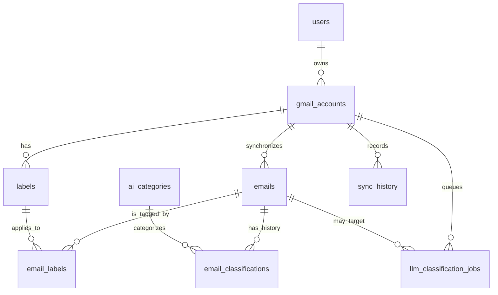

# Database architecture and operations

## Ownership and dependency map



`app.core.config` reads `DATABASE_URL` and pooling values; `app.database.connection`
creates the only engine/session factory and FastAPI dependency. `app.models.email`
owns every physical table/column mapping; `app.models.llm` owns only durable job
mapping. `database.crud` persists OAuth identities; `gmail_service` upserts
messages, labels and account cursor data; `llm_classification_service` reads
unclassified messages and persists the current classification; routes use models
and services but do not contain physical table SQL. `core.security` resolves user
ownership, and every email/label route scopes queries through `GmailAccount.user_id`.

## Tables

All timestamps are `TIMESTAMPTZ` (`DateTime(timezone=True)`); identifiers are
UUIDs. `CASCADE` removes data owned solely by a deleted account/email. Category
references are `RESTRICT` so audit history is not silently reclassified.

| Table | Columns (besides `id UUID PK`) | Integrity/indexes |
| --- | --- | --- |
| `users` | `google_id varchar(255)`, `email varchar(320)`, `name`, `picture`, timestamps | unique `google_id`, unique `email` |
| `gmail_accounts` | `user_id`, `email_address`, `provider`, `gmail_user_id`, OAuth token fields, `sync_status`, `last_synced_at`, `history_id`, preference, timestamps | FK user CASCADE; unique `(user_id,email_address)`; user index |
| `emails` | `gmail_account_id`, `gmail_message_id`, `gmail_thread_id`, sender/recipient metadata, content, flags, JSON metadata, timestamps | FK account CASCADE; unique `(gmail_account_id,gmail_message_id)`; account/received, account/thread, account/read indexes |
| `labels` | `gmail_account_id`, `gmail_label_id`, `name`, `label_type`, timestamps | FK account CASCADE; unique `(gmail_account_id,gmail_label_id)`; account/name index |
| `email_labels` | `email_id`, `label_id`, `gmail_account_id`, timestamp | composite PK `(email_id,label_id)` and composite FKs to email/account and label/account; prevents cross-account links |
| `ai_categories` | `name`, `description`, `is_active`, timestamps | unique canonical name; only controlled category definitions are seeded |
| `email_classifications` | `email_id`, `category_id`, confidence, model/prompt versions, status/reason/current flag, timestamps | confidence `[0,1]`, status check; FK email CASCADE/category RESTRICT; partial unique current-success slot per email |
| `sync_history` | `gmail_account_id`, `sync_type`, status, timing, message/label counts, error text | FK account CASCADE; status check; account/start index |
| `llm_classification_jobs` | account/email target, type/status, retry fields, safe schedule/timing/error, UI progress counters | FKs account/email CASCADE; checks; claim index; partial unique active batch/per-email job indexes |

Physical names deliberately differ from selected Python attributes: for example,
`GmailAccount.email → email_address`, `Email.body → body_text`,
`Label.label_id → gmail_label_id`, and `SyncHistory.trigger → sync_type`.
API JSON remains unchanged by those mappings.

## Migration and startup

From `backend`, set `DATABASE_URL` in `.env` (or process environment), then:

```powershell
python -m pip install -r requirements.txt
alembic upgrade head
uvicorn app.api.app:app --reload --port 8000
```

The only migration is `alembic/versions/20261012_0001_rebuild_gmail_dashboard_schema.py`.
It creates this schema in the configured existing database, seeds the approved AI
category definitions only, and does not create users, email messages, labels, or
classification records. Startup validates all nine tables and fails with a clear
migration command instead of making unversioned DDL changes. Do not use
`alembic downgrade` on a live database: its rollback drops the schema.

## Inspection SQL

```sql
SELECT table_name FROM information_schema.tables
WHERE table_schema = 'public' ORDER BY table_name;

SELECT table_name, column_name, data_type, is_nullable
FROM information_schema.columns
WHERE table_schema = 'public' ORDER BY table_name, ordinal_position;

SELECT indexname, indexdef FROM pg_indexes
WHERE schemaname = 'public' ORDER BY tablename, indexname;

SELECT tc.table_name, tc.constraint_name, tc.constraint_type,
       kcu.column_name, ccu.table_name AS foreign_table, ccu.column_name AS foreign_column
FROM information_schema.table_constraints tc
LEFT JOIN information_schema.key_column_usage kcu
  ON tc.constraint_name = kcu.constraint_name AND tc.table_schema = kcu.table_schema
LEFT JOIN information_schema.constraint_column_usage ccu
  ON tc.constraint_name = ccu.constraint_name AND tc.table_schema = ccu.table_schema
WHERE tc.table_schema = 'public' ORDER BY tc.table_name, tc.constraint_name;
```

## Processing flows

**Gmail sync:** authenticate → resolve the owned Gmail account → create sync
history → list labels and upsert by account-scoped Gmail label ID → list/fetch
messages with pagination → account-scoped message upsert → insert only missing
email-label mappings → commit → advance account history cursor and timestamp →
record successful/failed sync → enqueue an enabled account's classification job.
Repeated messages are updated rather than duplicated. Tokens are never returned
from serializers or logged.

**AI/backfill:** an enabled account submits one active batch job → worker claims
the pending job atomically → selects account-scoped emails with no current
successful classification → calls the existing LangChain provider outside a DB
transaction → validates the approved category and 0–1 confidence → stores the
current successful classification → updates job counts/status. Failed calls keep
the earlier successful classification and are retryable through the existing API.

## Safe renames

To move **the database name**, stop API/workers, create/rename the database using
your DBA-approved PostgreSQL operation, update only `DATABASE_URL`, run
`alembic current`/`alembic upgrade head`, reconnect/restart, then health-check.
No source file contains a database name.

To rename **a table or column**, first inventory it with `rg`, then add a new
Alembic revision using `op.rename_table` or `op.alter_column(..., new_column_name=...)`.
Update the central model mapping (not route payload keys), repository/service
queries, indexes and FKs; deploy an expand/contract migration for zero downtime;
run the schema and API regression tests before retiring compatibility code. Never
drop/recreate a populated renamed column as a shortcut.
